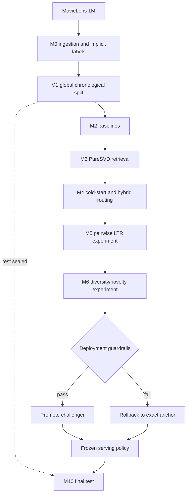

# Architecture

## Offline path



The key methodological rule is that M2–M6 use validation for model selection while test remains untouched. M10 evaluates the already frozen policy; it does not refit or tune on test.

## Online path

```mermaid
flowchart LR
    U[User request] --> A[Sticky SHA-256 assignment]
    A --> G{Offline challenger eligible?}
    G -->|no| C[Serve control policy]
    G -->|yes| P[Serve assigned policy]
    C --> R[M4 candidate generation]
    P --> R
    R --> Q[Top-100 candidates]
    Q --> L[M5 selected ordering]
    L --> D[M6 deployed reranking]
    D --> T[Top-K response]
    T --> X[Exposure JSONL]
    X --> O[Outcome endpoint]
    T --> M[/metrics and /v1/ops]
```

## Artifact contract

The service does not retrain at startup. M8 builds one frozen `serving_bundle.npz` containing the selected retrieval/ranking/reranking parameters and train-derived state. M9 verifies its SHA-256 against the manifest before admitting traffic.

`/health` is liveness-only. `/ready` is fail-closed: if the bundle is missing, corrupted or has invalid provenance, recommendation traffic is rejected.

## Experiment safety

Assignment and serving are intentionally distinct fields:

- `assigned_variant`: deterministic experiment assignment;
- `served_variant`: policy actually served after the offline safety gate.

A user can therefore be assigned to treatment but still receive control when the challenger was rejected offline. This preserves auditability without exposing users to a policy that failed deployment guardrails.
